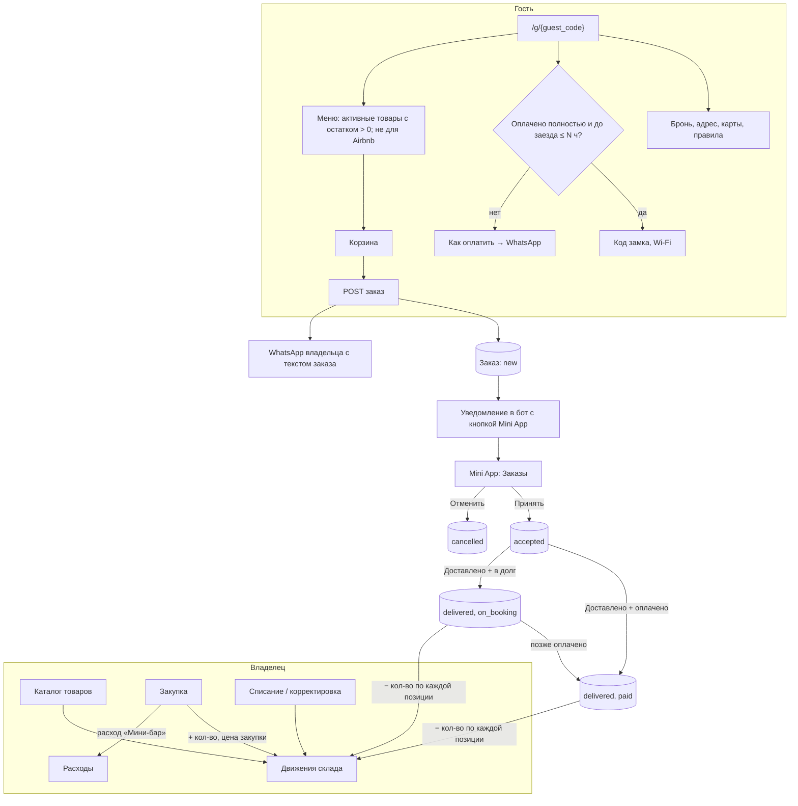

# Мини-бар, склад и панель гостя

Статус: утверждена пользователем 25 окт 2026, поправлена после исследования рынка в тот же день. Код по этой спецификации пишет отдельная сессия, PR за PR.

## 1. Цель

1. Владелец ведёт товары мини-бара: каталог, закупки, остатки.
2. Гость получает личную ссылку на свою бронь. Там вся информация о проживании и меню мини-бара.
3. Гость заказывает из меню. Заказ записывается в Day и уходит владельцу в WhatsApp.
4. Владелец доставляет заказ и отмечает оплату. Остаток на складе уменьшается сам.

Основа интерфейса панели — прототип «Mosh Mosh» (`hotel guest panel.rtf`): плитки, нижние шторки, корзина, текст заказа в WhatsApp, три языка.

## 2. Решения пользователя

| Вопрос | Решение |
|---|---|
| Где лежат товары | Только общий склад компании. Мини-бара по квартирам нет. |
| Как гость платит за заказ | Отдельно при доставке. Если при доставке не оплатил — владелец нажимает «В долг», и сумма показывается в долге гостя по этой брони. |
| Где живёт заказ | В Day, и параллельно у гостя открывается WhatsApp с готовым текстом. |
| Код замка и Wi-Fi | Полная оплата брони (`paid_amount ≥ total_price`) **и** не раньше N часов до заезда. N по умолчанию: 24 ч для посуточной, 1 ч для почасовой; владелец меняет в настройках. После выезда скрыты. |
| Мини-бар для гостей Airbnb | Не показывать: Airbnb запрещает брать деньги в обход платформы. Booking.com и прямым гостям — показывать. |
| Языки панели | ru, kz, en. Только свои тексты, без машинного перевода. |
| Связь гостя с владельцем | Ссылки на WhatsApp (`wa.me`). Серверной рассылки нет. |
| Создание квартиры в Mini App | Не нужно. |
| Чат-консьерж из прототипа | Не нужен. Диалоги с гостями ведёт CRM aidyn. |
| Услуги (уборка, бельё, документы и т.п.) | Кнопки WhatsApp с готовым текстом, не товары меню. |

## 3. Схема

## 4. Данные

Новая миграция `053`. Все таблицы с `company_id`, все запросы фильтруются по нему.

### 4.1 `products` — каталог

| Поле | Тип | Правило |
|---|---|---|
| `id` | uuid | |
| `company_id` | uuid FK | индекс |
| `name` | str(120) | обязательно |
| `category` | str(40) | свободный текст: «Напитки», «Снеки», «Завтрак» |
| `description` | text, null | |
| `photo_url` | str, null | MinIO, как фото квартиры |
| `price` | Numeric(12,2) | цена гостю, `0 ≤ price ≤ 9 999 999 999.99` |
| `is_active` | bool | неактивный товар не виден гостю |
| `sort_order` | int | порядок в меню |
| `par_level` | int, null | порог: при остатке ниже товар попадает в список «Что докупить» |
| `created_at`, `archived_at` | datetime | товар не удаляется, а архивируется: на него ссылаются движения |

Название одно, на языке владельца. Переводы названий — позже, если понадобится.

### 4.2 `stock_movements` — журнал склада

Остаток не хранится полем. Остаток = сумма `quantity` по товару. Так история не теряется, и два одновременных действия не затирают друг друга.

| Поле | Тип | Правило |
|---|---|---|
| `id`, `company_id`, `product_id` | uuid | |
| `kind` | str | `purchase` (+), `sale` (−), `writeoff` (−), `adjust` (±) |
| `quantity` | int | знак по `kind`; `0` запрещён |
| `unit_cost` | Numeric(12,2), null | только для `purchase` |
| `order_id` | uuid FK, null | для `sale` |
| `expense_id` | uuid FK, null | для `purchase` |
| `note` | text, null | |
| `created_by`, `created_at` | | |

**Закупка** создаёт движение `purchase` и расход в `expenses` с новой категорией `minibar` на сумму `quantity × unit_cost`. Так закупки попадают в «Расходы» и в будущий отчёт о прибыли.

### 4.3 `guest_orders` и `guest_order_items`

`guest_orders`:

| Поле | Тип | Правило |
|---|---|---|
| `id`, `company_id`, `booking_id`, `property_id` | uuid | |
| `number` | int | номер заказа в компании, для текста WhatsApp |
| `status` | str | `new` → `accepted` → `delivered`; `new`/`accepted` → `cancelled` |
| `total` | Numeric(12,2) | сумма позиций на момент заказа |
| `guest_note` | text, null | «без льда», «к 22:00» |
| `payment_status` | str, null | `null` до доставки; `paid` или `on_booking` («в долг») при доставке; `on_booking` → `paid` позже |
| `payment_method` | str, null | `cash` / `card` / `transfer`, ставится при оплате |
| `paid_at` | datetime, null | |
| `created_at`, `accepted_at`, `delivered_at`, `cancelled_at` | datetime | |
| `handled_by` | uuid, null | кто доставил или отменил |

`guest_order_items`: `order_id`, `product_id`, `name` и `price` — копия на момент заказа, `quantity` (1…20).

Оплата заказа хранится в самом заказе. В `booking_payments` она не попадает, и `bookings.total_price` не меняется: так не ломается пересчёт цены брони.

**Долг гостя** по брони = долг за проживание (`total_price − paid_amount`) + сумма заказов `on_booking`. Его показывают карточка брони, вкладки «Брони» и «Деньги», панель гостя. Оплата такого заказа — кнопка «Оплачено» у заказа, а не платёж брони.

### 4.4 Ссылка гостя

В `bookings` новое поле `guest_code` str(16), уникальное, случайное. Это длиннее кодов `/s/` (7) и `/o/` (8): ссылка открывает код замка. Создаётся при создании брони, для старых броней — в миграции. Ссылка: `{PUBLIC_APP_URL}/g/{guest_code}`.

### 4.5 Настройки компании

В `company_settings`: `secrets_lead_hours_daily` (int, по умолчанию 24) и `secrets_lead_hours_hourly` (int, по умолчанию 1), от 0 до 168. Меняются в веб-настройках.

## 5. Панель гостя `/g/{guest_code}`

Публичная страница без входа. Языки: ru, kz, en (переключатель, как в прототипе; не 9 языков GuestFrame). Мобильная вёрстка.

| Блок | Что показывает | Когда |
|---|---|---|
| Шапка | Название компании, квартира, даты и время заезда и выезда | Всегда |
| Карты | Ссылки Яндекс, 2ГИС, Google: по `latitude/longitude`, иначе по адресу; `map_url` квартиры, если задан | Всегда |
| Оплата | Сколько оплачено и сколько осталось, включая заказы «в долг». Кнопка «Как оплатить» → WhatsApp | Пока есть долг |
| Заселение | Инструкция заселения, Wi-Fi, факты квартиры с доступом `guest` (отдельного поля «код замка» нет: код лежит в инструкции и фактах) | Бронь `confirmed` или `checked_in` **и** оплачено полностью **и** до заезда не больше N часов (раздел 4.5) **и** выезд ещё не наступил. До этого — строка «Откроется после оплаты, за N ч до заезда» |
| Правила | Правила дома, время выезда, инструкция выезда | Всегда |
| Мини-бар | Меню по категориям, корзина, заказ | Бронь `confirmed` или `checked_in`, от дня заезда до выезда, источник брони не `airbnb` |
| Кнопки | Кнопки WhatsApp с готовым текстом, см. раздел 5.1 | По таблице 5.1 |

Отменённая или завершённая бронь показывает только «Бронь закрыта» и контакт.

### 5.1 Кнопки панели

Каждая кнопка открывает WhatsApp владельца с готовым текстом на языке панели. В текст всегда входят: имя гостя, квартира, даты брони. Day эти запросы не записывает: решение принимает владелец в переписке.

| Кнопка | Текст (ru) | Когда видна |
|---|---|---|
| Как оплатить | «Здравствуйте! Хочу оплатить бронь {даты}, кв. {квартира}. Осталось {сумма} ₸. Подскажите реквизиты.» | Пока есть долг |
| Ранний заезд | «…Можно заехать раньше {время заезда}?» | Бронь подтверждена, до заезда |
| Не могу войти | «…Не получается войти в квартиру. Помогите, пожалуйста.» | День заезда и проживание, в том числе до оплаты; выделена цветом |
| Продлить проживание | «…Хочу продлить проживание. На сколько ночей можно?» | Проживание |
| Поздний выезд | «…Можно выехать позже {время выезда}?» | Проживание |
| Уборка или смена белья | «…Нужна уборка / смена белья.» | Проживание, от 2 ночей |
| Что-то сломалось | «…Что-то не работает: » (гость дописывает) | Проживание |
| Документы для отчётности | «…Нужны отчётные документы (чек, акт) за проживание.» | Всегда, кроме отменённой брони |
| Я выехал | «…Я выехал(а). Ключи: » (гость дописывает) | День выезда. Единственная кнопка, которую Day записывает: см. ниже |
| Задать вопрос | «Здравствуйте! Я {имя}, бронь {даты}, кв. {квартира}.» | Всегда |

**«Я выехал»** сначала шлёт `POST /public/guest/{guest_code}/checked-out`: владелец получает уведомление в бот, и создаётся задача уборки на эту квартиру, если её ещё нет. Статус брони не меняется: выезд подтверждает владелец. Потом открывается WhatsApp.

«Проживание» = статус `checked_in` или сегодня между датой заезда и датой выезда для `confirmed`.

Номер WhatsApp: `company_sites.whatsapp`. Если его нет, кнопки WhatsApp не показываются.

## 6. Заказ гостя

1. Гость собирает корзину и нажимает «Отправить заказ».
2. `POST /public/guest/{guest_code}/orders` с позициями и заметкой.
3. Сервер проверяет:
   - бронь в окне мини-бара (раздел 5), источник не `airbnb`;
   - товар активен, принадлежит той же компании, количество 1…20, позиций не больше 30;
   - остатка хватает на каждую позицию;
   - лимит частоты: не больше 5 заказов в час на бронь.
4. Сервер создаёт заказ `new`, считает `total` по текущим ценам, ставит уведомление в бот.
5. Ответ содержит номер заказа и ссылку `wa.me` с текстом: номер заказа, квартира, позиции, сумма, заметка.
6. Страница открывает WhatsApp. Если WhatsApp не открылся, заказ всё равно в Day.

Склад при создании заказа не уменьшается. Он уменьшается при «Доставлено».

## 7. Сторона владельца

### Веб: раздел «Склад»

- Товары: создать, изменить, фото, активен или нет, порядок, архив.
- Остатки: таблица товар → остаток, красным — меньше порога `par_level`.
- «Что докупить»: товары ниже порога и сколько не хватает до него.
- Закупка: товар, количество, цена закупки за штуку, дата → движение и расход.
- Списание и корректировка с причиной.
- История движений по товару.
- Заказы гостей: список с фильтром по статусу.

### Mini App

- Вкладка или раздел «Заказы»: новые сверху, кнопки «Принять», «Доставлено» (выбор: оплачено и способ, или «В долг»), «Отменить». У заказа «в долг» — кнопка «Оплачено».
- «Должны» во вкладках «Сегодня» и «Деньги» и в карточке брони учитывают заказы «в долг».
- «Доставлено» создаёт движения `sale` по каждой позиции в одной транзакции. Если остатка не хватает, Day всё равно проводит доставку, остаток уходит в минус и показывается красным: товар уже у гостя, а закупку просто забыли внести.
- Остатки только для просмотра. Закупка с телефона — во втором шаге, если понадобится.
- В карточке брони кнопка «Ссылка гостю» → WhatsApp гостю с текстом и ссылкой `/g/…`.

### Бот

- «Новый заказ №N, квартира, сумма» с кнопкой, которая открывает заказ в Mini App.
- «Гость выехал: квартира, имя» с кнопкой на бронь.

### Права

| Действие | Право |
|---|---|
| Видеть каталог, остатки, заказы | `bookings:read` |
| Принять, доставить, отменить заказ | `bookings:write` |
| Товары, закупки, списания | новое `inventory:manage` у владельца и менеджера |

## 8. Безопасность

- `guest_code` — 16 случайных символов. Подбор перебором закрыт лимитом запросов на публичные адреса.
- Публичный ответ не содержит телефонов и данных других гостей, только имя гостя этой брони.
- Код замка и Wi-Fi уходят в ответе, только если выполнено условие из раздела 5. Проверка на сервере, а не на странице.
- Цена позиции в заказе берётся с сервера, а не из запроса гостя.
- Новый публичный POST получает тот же жёсткий лимит, что бронь гостем: добавить путь заказа в `_GUEST_BOOK` в `app/infrastructure/rate_limiter.py` (сейчас 5 запросов). Чтение панели идёт под общим лимитом `/api/v1/public/`.

## 9. Разбивка на PR

| № | PR | Что внутри |
|---|---|---|
| A | Склад: сервер | Миграция `products` (с `par_level`), `stock_movements`, категория расхода `minibar`, право `inventory:manage`, API товаров, закупки, списания, остатков, «что докупить». Тесты. |
| B | Склад: веб | Раздел «Склад»: товары, остатки, «что докупить», закупка, списание, история. |
| C | Панель гостя: чтение | `bookings.guest_code` и миграция для старых броней, `GET /public/guest/{code}`, настройки `secrets_lead_hours_*`, страница `/g/{code}` без мини-бара: бронь, карты, оплата, заселение с проверкой оплаты и времени, правила, кнопки 5.1, «Я выехал» (уведомление + уборка). |
| D | Заказы: сервер и панель | `guest_orders`, `guest_order_items`, публичный POST, API владельца (список, принять, доставить, отменить), движения `sale`, `payment_status` с «в долг», долг гостя с учётом заказов (сервер), уведомление в бот. Меню и корзина на панели, скрыты для Airbnb. |
| E | Заказы: Mini App | Раздел «Заказы», кнопки статусов и «В долг»/«Оплачено», долг с заказами в «Сегодня», «Деньги» и карточке брони, остатки для просмотра, «Ссылка гостю» в карточке брони. |
| F | Ссылка для CRM | `guest_url` в ответах API броней и в ленте броней для aidyn_crm. Текст для CRM. |

C можно делать параллельно с A и B: они не пересекаются.

## 10. Не входит

- Чат-консьерж (ИИ на панели гостя).
- Оплата картой на панели.
- Мини-бар по квартирам (остатки в каждой квартире).
- Переводы названий товаров.
- Машинный перевод и языки сверх ru, kz, en.

## 11. Следующие фичи (по исследованию рынка, отдельно от этой спецификации)

1. **Ранний заезд и поздний выезд с ценой.** Ступени («заезд в 12:00 — 3 000 ₸, в 10:00 — 6 000 ₸»), запрос гостя с панели, подтверждение владельца, сумма в долг брони. По данным Guesty и Duve это главный источник дохода с панели, больше мини-бара.
2. **Сообщение со ссылкой на панель накануне заезда** через CRM aidyn — главный канал продаж допуслуг у Duve.
3. **Отметка расходников уборщицей** в Mini App («хватает / мало / нет»), как у Turno.
4. **Регистрация иностранцев в eQonaq** — сначала проверка у юриста: правила менялись в 2026 году.
5. **Страховка от ущерба вместо залога** — нужна юридическая оценка.

